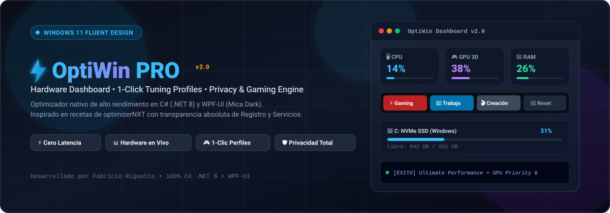

# ⚡ OptiWin PRO — Windows Performance, Privacy & Hardware Control

<p align="center">
  
  <br><br>
  
</p>

OptiWin es una aplicación de escritorio nativa de alto rendimiento desarrollada en **C# (.NET 8.0) y WPF** utilizando la librería oficial **WPF-UI (Windows 11 Fluent Design con efecto Mica)**.

Inspirada en el motor y las recetas comprobadas de [**optimizerNXT**](https://github.com/hellzerg/optimizerNXT), OptiWin combina un **Tablero de Hardware en tiempo real**, perfiles de optimización en 1 clic y control total sobre el registro, servicios y privacidad de Windows con máxima transparencia y advertencias contextuales de seguridad.

---

## ⚠️ Advertencias y Descargo de Responsabilidad

> [!WARNING]
> **Uso bajo tu propia responsabilidad:** OptiWin realiza modificaciones a nivel de Registro de Windows (`HKLM`/`HKCU`), adaptadores de red (DNS), servicios en segundo plano y planes de energía. Aunque todas las opciones han sido probadas minuciosamente y son 100% reversibles, utilízalas con comprensión y criterio según el perfil de uso de tu equipo.

> [!IMPORTANT]
> **Recomendaciones previas y consideraciones de seguridad:**
> 1. **Crea siempre un Punto de Restauración del Sistema:** Antes de aplicar cualquier perfil masivo (*Modo Gaming* o *Modo Creación*), utiliza el botón integrado **"Crear Punto Restauración"** en la barra lateral de OptiWin.
> 2. **Privilegios de Administrador (UAC):** La herramienta requiere ejecutarse con permisos elevados (`requireAdministrator`) para poder escribir directivas del sistema en `HKEY_LOCAL_MACHINE` y gestionar servicios de Windows.
> 3. **Falsos Positivos de Antivirus (Windows SmartScreen):** Al ser una aplicación en C# de código abierto sin un certificado comercial de firma de código digital de pago que interactúa con la memoria (`EmptyWorkingSet`) y claves sensibles del Registro, algunas soluciones antivirus o Windows SmartScreen pueden clasificarla preventivamente como sospechosa (*Riskware* / *HackTool*). El código fuente es 100% abierto, transparente y auditable en este repositorio.
> 4. **Redes Corporativas y VPN:** Si utilizas el equipo en un entorno empresarial con Active Directory o VPN corporativa, cambiar los servidores DNS o bloquear directivas de telemetría podría sobrescribir políticas de red requeridas por tu organización.

---

## 🚀 Características Principales

### 📊 1. Tablero de Hardware en Tiempo Real (Dashboard)
- **🖥️ Procesador (CPU):** Medición de carga de CPU en vivo mediante la API Win32 nativa (`GetSystemTimes`), con modelo exacto de procesador.
- **🎮 Tarjeta Gráfica (GPU):** Detección de la GPU dedicada principal (ej. AMD Radeon RX 6900 XT / NVIDIA GeForce) y monitoreo de uso del motor 3D en tiempo real mediante contadores de rendimiento de Windows.
- **🧠 Memoria RAM:** Porcentaje de uso, memoria ocupada y memoria disponible en GB actualizados cada 2 segundos.
- **💾 Almacenamiento Multinivel (Todos los discos):** Detección dinámica de todas las unidades fijas y extraíbles del equipo (C:, D:, E:, USB) con barras de progreso de color semántico (azul, naranja, rojo), espacio libre y capacidad total.
- **ℹ️ Especificaciones del Sistema:** Versión y compilación de Windows (10/11), nombre del equipo y tiempo de actividad ininterrumpido (*Uptime*).

---

### ⚡ 2. Perfiles de Optimización Masiva (1 Clic)
- 🎮 **Modo Gaming:** Activa el plan de energía *Ultimate Performance*, asigna prioridad 8 a la GPU, elimina el *Network Throttling*, desactiva GameDVR (para evitar micro-stuttering), asigna DNS Cloudflare (1.1.1.1) para menor ping y vacía la RAM.
- 💼 **Modo Trabajo:** Plan de energía equilibrado, búsqueda local rápida en Inicio sin Bing, soporte de rutas largas (>260 caracteres), telemetría de navegadores y Office bloqueada, y DNS Google (8.8.8.8).
- 🎬 **Modo Creación / Render:** Prioridad máxima de procesamiento para CPU y GPU, vaciado masivo de RAM para buffers de renderizado y cierre rápido de aplicaciones secundarias.
- 🔄 **Restaurar Fábrica:** Devuelve el plan de energía, los servidores DNS (a DHCP automático) y los ajustes del Registro a los valores predeterminados de Windows.

*Cada perfil cuenta con su propio botón de información **`?`** para previsualizar los ajustes y advertencias antes de aplicarlos.*

---

### 💡 3. Sistema de Explicación Detallada y Advertencias (`?`)
Cada optimización y perfil cuenta con un botón interactivo **`?`**:
- **Al pasar el cursor (Hover):** Muestra un ToolTip flotante estilizado con ajuste automático de línea que detalla la función e incluye las advertencias operativas.
- **En la tarjeta de cada tweak:** Indicador de advertencia destacado en color ámbar (`#fbbf24`) que resume posibles efectos secundarios.
- **Al hacer clic:** Abre una tarjeta modal dentro de la propia aplicación con:
  - **Explicación completa** de lo que hace el tweak.
  - **Panel de Advertencia dedicado** en color ámbar/amarillo destacado (`#f59e0b`).
  - **Ruta exacta de la clave de Registro (`HKLM`/`HKCU`) o Servicio de Windows** modificado.

---

### 🛠️ 4. Catálogo de Optimizaciones

#### ⚡ Rendimiento & Gaming
- **Network Throttling:** Desactiva la limitación artificial de paquetes de red en Windows (`NetworkThrottlingIndex: 0xFFFFFFFF`).
- **System Responsiveness:** Asigna el 100% de la capacidad de CPU a la aplicación activa en lugar de reservar 20% para tareas de fondo.
- **Prioridad de GPU para Juegos:** Eleva la prioridad del Multimedia Scheduler de Windows a GPU Priority 8.
- **Desactivar Xbox GameDVR:** Elimina la grabación en segundo plano constante para evitar caídas de FPS y stuttering.
- **AutoEndTasks:** Cierre instantáneo de aplicaciones colgadas al apagar o reiniciar el equipo (timeout reducido a 2 segundos).
- **Animaciones Instantáneas (0 ms):** Elimina el retraso de apertura de menús contextuales (`MenuShowDelay: 0`).
- **Rutas Largas (> 260 caracteres):** Elimina la restricción histórica `MAX_PATH` de Windows para desarrolladores.
- **Desactivar Teclas Especiales (Sticky Keys):** Evita la ventana emergente al presionar la tecla Shift 5 veces seguidas.

#### 🛡️ Privacidad & Telemetría
- **Desactivar DiagTrack:** Detiene y deshabilita el servicio de telemetría y diagnósticos continuos en segundo plano.
- **Desactivar Copilot en Windows 11:** Cierra el proceso permanente de IA en segundo plano y limpia la barra de tareas.
- **Telemetría de Navegadores:** Bloquea el envío de métricas de navegación en Google Chrome y Microsoft Edge.
- **Reportes de Errores (WerSvc):** Evita el bloqueo del sistema mientras se recopilan volcados de fallos para Microsoft.
- **Búsqueda Web en Inicio:** Elimina las consultas a Bing desde el menú de inicio para una búsqueda local más rápida y privada.

---

### 🌐 5. Red y Servidores DNS
- **Cloudflare DNS:** `1.1.1.1` / `1.0.0.1` (mínima latencia para juegos).
- **Google Public DNS:** `8.8.8.8` / `8.8.4.4` (máxima compatibilidad).
- **Quad9 DNS Seguro:** `9.9.9.9` / `149.112.112.112` (bloqueo de sitios maliciosos a nivel de red).
- **Restaurar DHCP:** Vuelve a la configuración automática del proveedor de internet con vaciado de caché (`ipconfig /flushdns`).

---

### 🚀 6. Gestión de Inicio & Bloatware UWP
- **Gestor de Inicio:** Lista los programas que arrancan automáticamente con Windows (`HKCU\Run` y `HKLM\Run`) y permite deshabilitarlos para un encendido más rápido.
- **Desinstalador de Bloatware UWP:** Desinstala con un clic aplicaciones preinstaladas innecesarias (Cortana, Bing Noticias, Bing Clima, Centro de Comentarios, Solitario, Mapas, etc.).

---

### 🧹 7. Limpieza Profunda & Liberador de RAM
- **Limpiador de Disco:** Escanea y elimina archivos basura en `%TEMP%`, `C:\Windows\Temp`, `Prefetch`, volcados de error y vacía la Papelera de Reciclaje mediante la API Win32 (`SHEmptyRecycleBin`).
- **Liberador de RAM:** Vacía el *Working Set* de los procesos en ejecución (`EmptyWorkingSet` de `psapi.dll`), recuperando cientos de megabytes en caliente.

---

### 🛡️ 8. Punto de Restauración del Sistema
- Botón directo en la barra lateral para crear un punto de restauración antes de realizar cambios profundos en el sistema.

---

## 📂 Arquitectura del Proyecto

```plaintext
OptiWin/
├── images/
│   ├── banner.svg            # Banner vectorial Fluent para el repositorio
│   └── hero_banner.png       # Renderizado promocional en alta resolución
├── Core/
│   ├── HardwareMonitor.cs    # Monitoreo de CPU (GetSystemTimes), Discos múltiples y Specs
│   ├── GpuMonitor.cs         # Lectura en vivo de contadores GPU Engine 3D
│   ├── RamOptimizer.cs       # Lectura GlobalMemoryStatusEx y vaciado EmptyWorkingSet
│   ├── DnsManager.cs         # Gestión de adaptadores de red y flush DNS
│   ├── PowerPlanManager.cs   # Desbloqueo y activación de Ultimate Performance
│   ├── StartupManager.cs     # Lectura y eliminación de apps en HKCU/HKLM Run
│   ├── UwpCleaner.cs         # Desinstalación de paquetes UWP de bloatware
│   ├── RestorePointHelper.cs # Creación de puntos de restauración de Windows
│   ├── CleanerService.cs     # Escaneo y vaciado de temporales y papelera
│   ├── RegistryHelper.cs     # Manipulación segura de HKLM y HKCU
│   ├── ServiceHelper.cs      # Control de servicios de Windows (Start / Stop / Disable)
│   ├── AppLogger.cs          # Consola de actividad reactiva en tiempo real
│   ├── Tweaks/
│   │   ├── TweakModel.cs     # Modelo con propiedades técnicas, advertencias y enlace reactivo
│   │   └── TweakManager.cs   # Catálogo completo con explicaciones y advertencias
│   └── Profiles/
│       └── ProfileManager.cs # Ejecución orquestada de perfiles (Gaming, Trabajo, Creación)
├── MainWindow.xaml           # Interfaz moderna WPF-UI (Fluent, Mica, Dark Theme) con modales
├── MainWindow.xaml.cs        # Lógica de presentación, timers, perfiles y modales explicativos
├── App.xaml                  # Diccionarios de temas y controles de WPF-UI
├── app.manifest              # Elevación de privilegios de Administrador (requireAdministrator)
├── .gitignore                # Reglas de exclusión para .NET y Visual Studio
└── OptiWin.csproj            # Configuración de compilación .NET 8.0 Windows
```

---

## 🔨 Compilación y Distribución

### Requisitos:
- Windows 10 o Windows 11
- .NET 8.0 SDK

### Compilar en modo Debug:
```bash
dotnet build
```

### Generar ejecutable único portátil (Release):
```bash
dotnet publish -c Release -r win-x64 --no-self-contained -p:PublishSingleFile=true
```
El archivo independiente compilado queda en:  
`bin\Release\net8.0-windows\win-x64\publish\OptiWin.exe`

---

## 📜 Licencia y Créditos
- Desarrollado por **Fabricio Riguetto**.
- Inspirado en la arquitectura y recetas de optimización de [**hellzerg/optimizerNXT**](https://github.com/hellzerg/optimizerNXT).
- Componentes visuales provistos por [**WPF-UI**](https://github.com/lepoco/wpfui) (Lepo).
